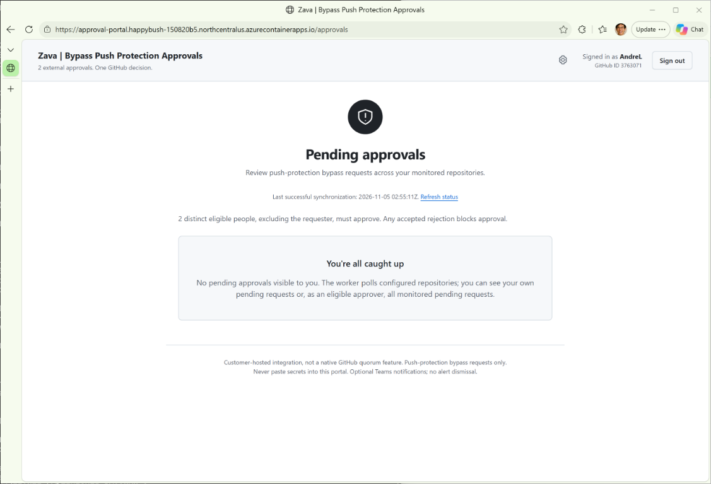
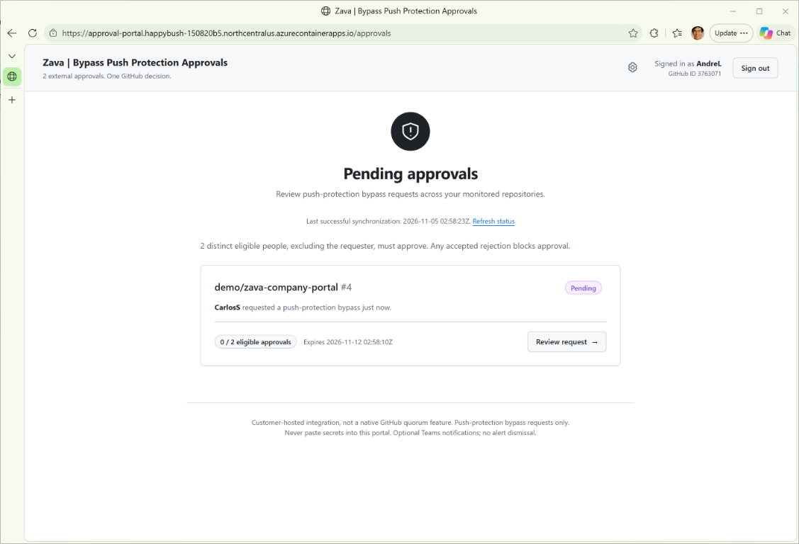
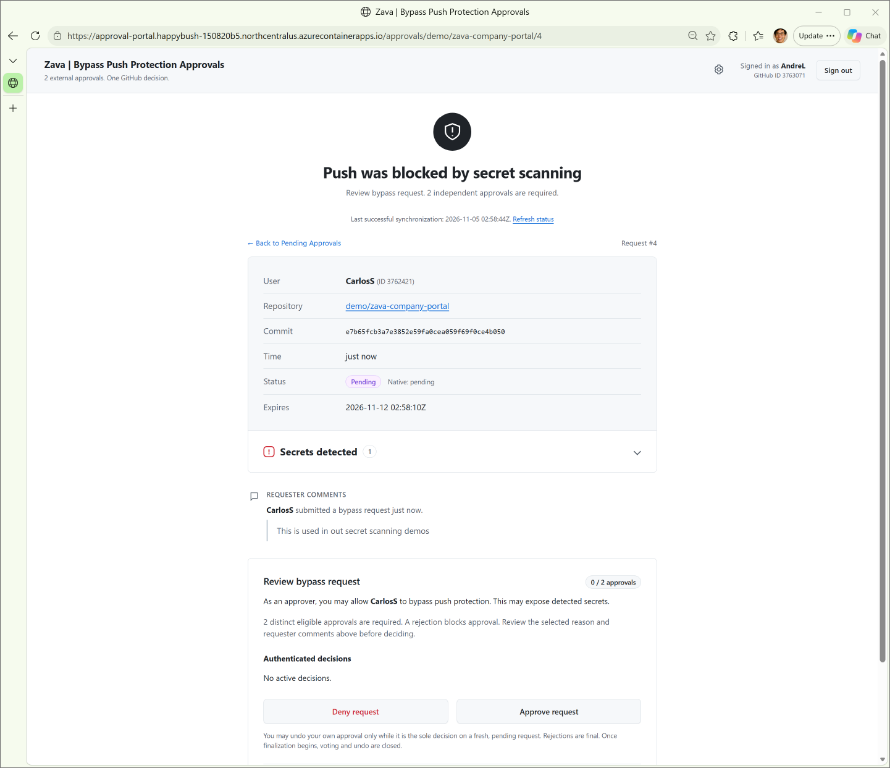

# Setup and operations reference

A customer-hosted .NET 10 / Blazor portal that collects a quorum of approvals (default two), then submits one native GitHub push-protection bypass review. It polls GitHub and stores state on disk; no database or separate worker is needed.

**This is a custom integration, not a native GitHub quorum.** Privileged GitHub users can still act outside the portal. Use a disposable repository and fake test secrets when validating it.

## Portal experience

**Empty queue.** Signed-in users see when there are no pending requests visible to them.



**Pending request.** Each card shows the requester, approval count, expiry, and a link to review.



**Review page.** Reviewers inspect request details, detected-secret metadata, and comments before approving or denying.



## GitHub App setup

One organization-owned GitHub App handles both reviewer sign-in and worker API calls.

### 1. Register the App

Open **Organization settings > Developer settings > GitHub Apps > New GitHub App** as an organization owner or authorized App manager.

| Field | Value |
|---|---|
| Homepage URL | `https://localhost:7443` locally; your HTTPS origin in production |
| Callback URL | `https://localhost:7443/signin-github` locally; `<HTTPS-origin>/signin-github` in production |
| Request user authorization during installation | Off |
| Device Flow | Off |
| Expire user authorization tokens | On |
| Webhook > Active | Off; the portal polls |
| Installation access | Only on this account |

Set these permissions before creating the App:

| Permission group | Permission | Access |
|---|---|---|
| Organization | Organization bypass requests for secret scanning | Read and write |
| Repository | Secret scanning alerts | Read-only |

No repository contents writes or administration permissions are needed. Validate list/get/review access in your test repository; GitHub's [permission table](https://docs.github.com/en/enterprise-cloud@latest/rest/authentication/permissions-required-for-github-apps#organization-permissions-for-organization-bypass-requests-for-secret-scanning) documents the required combinations.

### 2. Install and collect credentials

1. Select **Install App**, choose your organization, and select only the repositories the portal will monitor. Have an authorized owner approve the installation and any later permission changes.
2. Record the **App ID** and **Client ID** from the App's General page.
3. Generate a **client secret** and a **private key**. These are different credentials.
4. Open the installed App's configuration page and copy the numeric **Installation ID** from `/installations/12345678`.
5. Enable Secret Protection, push protection, and delegated bypass on the test repository. Your subscription must support delegated bypass; installing the App does not enable it.

Use these values in the untracked `.env`:

| GitHub value | Configuration |
|---|---|
| Client ID | `GITHUB_OAUTH_CLIENT_ID` |
| Client secret | `GITHUB_OAUTH_SECRET` |
| App ID | `GITHUB_APP_ID` |
| Installation ID | `GITHUB_INSTALLATION_ID` |
| Downloaded private key | Save as `secrets/github-app.pem` |

**Never commit `.env`, private keys, or webhook URLs.** Restrict their filesystem permissions. Client ID and App ID are not interchangeable; the PEM is not the OAuth secret.

### 3. Add reviewers

Resolve each reviewer's numeric GitHub ID:

```powershell
gh api users/REVIEWER_LOGIN --jq .id
```

Set `APPROVER_IDS` to at least two distinct positive IDs, for example `10,20,30`. `REQUIRED_APPROVALS` defaults to two and cannot exceed the number of approvers. Include enough non-requesters to reach quorum: requesters cannot approve their own requests.

Reviewers sign in **from the portal**, not by visiting the callback directly. They do not need to install the App on their personal accounts. GitHub sign-in establishes identity; only the portal allowlist grants approval rights.

### Optional link on blocked pushes

Set the organization's blocked-push resource link to `<HTTPS-origin>/approvals`. This is a static link, not an automatic notification or request-ID template. Users must create a native bypass request first and wait for synchronization. Links never grant access.

## Local run

Requires the **.NET 10 SDK**. From the repository root in PowerShell:

```powershell
Copy-Item .env.example .env
```

Fill in the GitHub values above, the repository, and `APPROVER_IDS`; set `PORTAL_ENABLED=true`. Save the PEM as `secrets/github-app.pem`, then run:

```powershell
dotnet dev-certs https --trust
.\Start-LocalDev.ps1
```

Open **https://localhost:7443/approvals**. The launcher loads `.env`, starts `dotnet watch`, and uses the repository's `data` directory. It overrides the Compose origin with the local HTTPS URL; use `-Url` to change it and register the matching callback. HTTPS is required even locally.

For GitHub Enterprise, set `GITHUB_HOST` to the hostname only. Enterprise Server API availability depends on its version.

To try the workflow, create a native bypass request as a non-approver, wait for a successful sync, then review from separate reviewer browser profiles. Below quorum, GitHub stays pending; quorum queues approval, while one accepted rejection queues denial. After approval, the developer retries the push. The sole approver can undo their vote while the request is fresh and pending; rejections cannot be undone.

Stop with Ctrl+C and keep `data` across restarts. To start without live integration:

```powershell
dotnet run --project src\ApprovalPortal -- --urls http://localhost:5000
```

Without configuration, this shows a setup-required portal and makes no live calls. Plain `dotnet run` does **not** load `.env`; use the launcher for configured local development.

## Configuration

For direct ASP.NET configuration, use `Portal:Name` in configuration providers or `Portal__Name` in environment variables. Use external secret files or a secret manager in production.

| Setting | Purpose |
|---|---|
| `Enabled` | Explicit opt-in; default `false` |
| `PublicOrigin` | External HTTPS origin, without a path or query |
| `GitHubHost` | Hostname only; default `github.com` |
| `OAuthClientId`, `OAuthClientSecret` | Browser sign-in credentials; `OAuthClientSecretFile` takes precedence over the secret value |
| `AppId`, `InstallationId`, `AppPrivateKeyFile` | Worker installation credentials |
| `Repositories__0`, `Repositories__1`, ... | Explicit `owner/repo` entries |
| `ApproverIdsCsv`, `RequiredApprovals` | Numeric reviewer allowlist and quorum |
| `OrganizationSlug` | Display label; default `Customer` |
| `PollSeconds` | 5-3600 seconds; default 60; failures back off |
| `DataDirectory` | Persistent state and cookie keys; local `data`, container `/data` |
| `StorageProvider` | Keep `FileSystem` |
| `TrustedProxies__0`, ... | Exact trusted reverse-proxy IPs; one forwarded hop |
| `TeamsWebhookUrl` | Optional secret Teams Workflows URL |

### Persistent configuration and Settings

`DataDirectory/config.json` is a flat JSON object whose explicitly present properties override environment/user-secrets values. Arrays replace rather than append. Keep credentials, `GitHubHost`, `DataDirectory`, and `TeamsWebhookUrl` external; invalid files fail explicitly rather than falling back.

Bootstrap the reviewer allowlist and quorum before first sign-in. Current approvers can open **Settings** to change the company label, reviewers, and quorum. Saves persist immediately and affect pending requests without a restart; removed approvals stop counting, but accepted rejections remain blocking. Other manual configuration changes require a restart.

**Any current approver can change the policy**, including replacing reviewers or lowering the quorum to two. Govern these accounts accordingly. Stale Settings forms conflict rather than overwrite newer changes. Never delete configuration/storage lock files while running.

## Optional Teams notifications

1. In **Teams > Workflows**, create a workflow using **When a Teams webhook request is received**, posting Adaptive Cards to your channel. Choose **Anyone** as the caller; token-authenticated workflows are not supported. Add co-owners.
2. Set `TEAMS_WEBHOOK_URL` in the untracked `.env` (production: `Portal__TeamsWebhookUrl`) and restart.
3. Create a bypass request and verify both the channel card and the workflow run history.

Cards include the repository, request number, expiry, and review link, not comments or secret metadata. Existing pending requests without delivery markers are also notified. Delivery is at least once: retries or crashes can produce duplicate cards. Notification failures do not block voting or retry native reviews. Blank configuration disables notifications; otherwise share review links manually. No email or final-decision notifications are sent.

## Docker and Compose

Configure `.env` and the PEM as above, set `STORAGE_PROVIDER=FileSystem`, then:

```powershell
docker compose up --build -d
```

Terminate HTTPS at a trusted reverse proxy, preserve `Host`, forward `X-Forwarded-Proto: https`, and configure its exact IP in `TrustedProxies`. Do not expose the container's HTTP listener directly.

Keep the `portal-data` volume and **one replica**. The non-root container uses UID 1654 and port 8080; bind mounts must permit that UID to write `/data` and read the PEM. Restrict Docker access: Compose passes the OAuth secret through the environment. Never share rendered Compose configuration.

## Azure Container Apps

[`infra/main.bicep`](../infra/main.bicep) provisions Basic ACR, managed-identity image pulls, one Consumption Container App, and a 5-GiB Azure Files share mounted at `/data`. The PEM uses a separate secret mount. This is a deployment starting point, not production hardening: no Key Vault, private networking, backups, or retained-log destination is included.

1. Put parameters in a protected file **outside the repository**: `githubAppId`, `githubInstallationId`, `githubOAuthClientId`, secure `githubOAuthSecret`, and secure `githubAppPrivateKey` (preserve PEM newlines). Supply `repository` and `approverIds`, or bootstrap them in persistent configuration. Optional parameters include `githubHost`, `requiredApprovals`, `teamsWebhookUrl`, `organizationSlug`, `name`, `location`, and `pollSeconds`.
2. Deploy without `image` to provision infrastructure:

   ```powershell
   az deployment group what-if --resource-group YOUR_RESOURCE_GROUP --template-file .\infra\main.bicep --parameters '@C:\secure\approval-portal.parameters.json'
   az deployment group create --resource-group YOUR_RESOURCE_GROUP --template-file .\infra\main.bicep --parameters '@C:\secure\approval-portal.parameters.json'
   ```

3. Build with `az acr build --registry YOUR_REGISTRY --image approval-portal:YOUR_TAG .`, using the output `registryName`. Exclude credentials and state from the build context.
4. Set `image` to the immutable digest reference in the output `registryLoginServer`; preview and deploy again. The deployment principal needs permission to create the registry role assignment.
5. Register the output `oauthCallbackUrl` in the GitHub App and set its homepage to the portal origin.

Keep traffic behind ACA's managed HTTPS ingress; its forwarded-header configuration must not be reused on an unprotected listener. Azure Files uses shared-key access: restrict administration and plan key rotation, backups, and recovery. Preserve UID 1654 and `cache=strict`; do not add `nobrl`.

**Single revision mode can still overlap during updates.** Stop/deactivate the old revision and confirm its worker has exited before starting a replacement against the same share; accept downtime. Validate cross-process locking, conditional writes, durable flush, atomic rename, and backup restoration on Azure Files before enabling real approvals. Startup probes and local tests are not platform certification.

## Operations and safeguards

- **Health:** `/health` reports liveness and configuration completeness, not GitHub/storage readiness. Monitor the last successful synchronization and operator logs.
- **Storage:** preserve the entire data directory, including `config.json`, `approvals`, and cookie keys. Use private encrypted storage with exclusive locks, conditional writes, durable flush, and atomic rename. Cloud-synced folders and active-active replicas are unsupported. Stop before moving/restoring state; never replace a ledger with an empty directory to recover.
- **Capacity:** the whole-file ledger is limited to 10,000 requests / 16 MiB. Archive only under controlled maintenance after preserving audit backups; there is no automatic retention job.
- **Audit:** raw secret values are not stored, but comments and paths may contain sensitive data. Storage administrators can alter evidence; restrict access and retain audit history externally. Cookie-key loss invalidates sessions; theft can permit forgery.
- **Native decisions:** `Sending` reserves the single attempt; `Submitted` awaits confirmation of the returned review ID. Only a matching native response yields `Approved`/`Denied`.
- **Uncertain writes:** timeouts, HTTP failures, or crashes after reservation are never blindly retried. Inspect GitHub and protected audit evidence. There is no reset/retry button; if evidence is insufficient, let the pending request expire and create a new one.
- **GitHub boundaries:** requests expire after seven days; approvals may permit future commits with the same secret. Native decisions and storage are not transactional, and privileged out-of-band actions remain possible.

### Troubleshooting

| Symptom | Check |
|---|---|
| Setup required | Effective configuration includes enabled integration, credentials, repository, writable state, and at least two numeric approver IDs |
| Callback/sign-in failure | Exact HTTPS callback, trusted certificate, matching client ID/secret, and sign-in started from the portal |
| GitHub 401 | App ID, installation ID, PEM, client-secret pairing, and machine clock; browser and worker credentials are separate |
| GitHub 403/404 or missing requests | Installation repository selection, approved permissions, delegated bypass, entitlements, and worker logs |
| Synchronization failed | Logged method/endpoint: token creation concerns installation authentication; organization bypass listing concerns organization access/permissions |
| Rate limiting | `X-RateLimit-Remaining` and backoff; nonzero remaining does not rule out secondary limits. `X-Accepted-GitHub-Permissions` describes required, not granted, permissions |
| Filesystem/configuration error | Permissions, corrupt state, stale Settings forms, or another writer; never delete active locks or the ledger |

## Verification

```powershell
dotnet build src\ApprovalPortal\ApprovalPortal.csproj -c Release
dotnet test tests\ApprovalPortal.Tests\ApprovalPortal.Tests.csproj -c Release
dotnet publish src\ApprovalPortal\ApprovalPortal.csproj -c Release
docker compose config --quiet
docker build -t customer-approval-portal .
```

Tests cover policy, voting, identity, persistence, uncertain writes, API protocols, notifications, and HTTP/antiforgery behavior. They do not certify live GitHub/Teams delivery or Azure Files. Before production, verify real OAuth, installation permissions, approval/rejection, timeout reconciliation, TLS/proxy behavior, persistence across replacement, and encrypted backup restoration.

References: [delegated-bypass REST](https://docs.github.com/en/enterprise-cloud@latest/rest/secret-scanning/delegated-bypass), [bypass behavior and expiry](https://docs.github.com/en/code-security/concepts/secret-security/bypass-requests), [GitHub App registration](https://docs.github.com/en/apps/creating-github-apps/registering-a-github-app/registering-a-github-app), and the original [design brief](Two-Approver-Secret-Protection.html).
